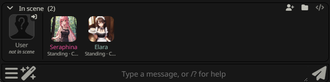
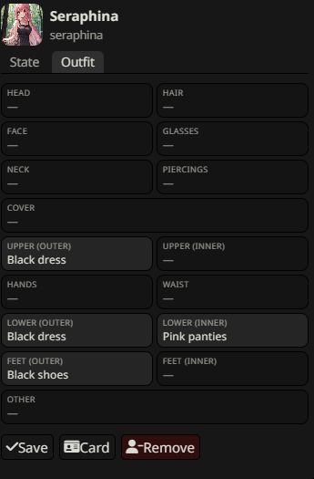
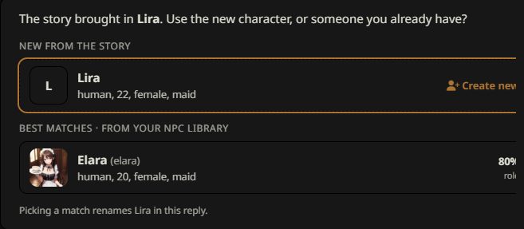

# NPC Book (SillyTavern extension)

I found Doom Enhancement SUite, RPGCompanion, SIM Tracker (etc, etc, etc) to be far too complicated and heavy for what I really care about. Which is "multiple-NPCs" in an "separate card-format" with "LLM can add/remove from scene and keep track of their state". So here is 'yet another' state tracker, which is light-weight (visually and in use), and does just that.

To prevent LLM Hallucination drift (User is standing, hair swaying in the wind, looking majestic) we use an ENUM-based approach, dictating what it can, and can not state (Standing, sitting, etc. It get's to pick one, or user can set it), exception is inner monologe(for obvious reasons).

**note:** 100% vibe-coded. I hate modding and extentions, so this is a quick way to get what I want without thinking about it too hard.

# Features:
- Dedicated NPC button to create NPCs (like lorebook/Character cards, but for 'characters', no longer do you have to choose a lesser of two evils).
- State tracking of Posture, Emotional state, inner thoughts, and outfit.
- Outfit tracking per body slot (paper doll): you or the LLM can put any clothing on anyone. Want NPCs to only wear what they own? Add the Wardrobe sister extension.
- Separate dressed-states to give the LLm headsup about what is currently the state (naked, has underwear on, etc).
- Full configuration of the Enum states, don't like a state? Change it.
- Profile generation if a character doesn't have one already.
- Speaker Cards with (optional) portrait' and their own dialogue color.
- Set starting cast in greetings (with per-greeting overrides).
- Export/import of characters
- LLM assisted Generation of character fields (if desired).
- Extendable: stat sheets, wardrobes, relationships or your own fields come as sister extensions (see below).

## Install
In SillyTavern, open **Extensions** (the stacked-cubes icon) → **Install extension**, paste this link and install:

```
https://github.com/lalzy/ST-NPC-Book
```

Or install it manually: download this repository and put the files in `SillyTavern/data/<your-user>/extensions/NPC-Book/`, then reload SillyTavern.

## Setup
1. Open **Extensions** → **NPC Book**, expand the **Injection** section and click **Add entries to Prompt Manager**.
2. Open your Prompt Manager. You'll find two new entries, *NPC Book — Instructions* and *NPC Book — Present NPCs*. Leave them where they are, or move them wherever you like.
3. Click the new **NPC Book** button in the top bar (next to Character Management) to start making NPCs.

Using Text Completion? There is no Prompt Manager there. In the **Injection** section, set **Mode** to *Auto inject* instead, or put `{{npcInstructions}}` and `{{npcScene}}` in your Story String yourself.

Every setting has an ⓘ icon: hover over it for a short explanation, or click it for the full text. Long prompts open in their own editor, with a **Reset to default** button.

## Using it

### NPC Library
The top-bar button  opens your NPCs where you have all of the details for the character. Details of the character written here are sent to the LLM when in the scene.
 

### Scene bar

Shown above the chat box with user on the left and everyone else currently in the scene to the right. If user is not in the scene it will be faded out gray. 

You can click on the character(s) to change their posture, mood, thoughts or outfits.


**Clothing:** Everyone has an outfit shown on a paper-doll. Some fields (piercings, other) can hold multiple items. You can manage the default outfit at the NPC Book menu entry for the character, or through JSON injection. See [starting cast](#starting-cast) below.



You can change the user's outfit in **Persona Management** → **Connections** → **NPC Book**.

For wardrobe functionality (clothing ownership tracking) install the [wardrobe extension](https://github.com/lalzy/ST-NPC-Book-wardrobe)


### NPC tracking
Current met NPCs are tracked in the metadata of the chat. So if you meet 30 NPCs, 30NPC IDs are tracked in the metadata sent to the LLM each message (only the name/ID is sent). So even if you have 5000+ NPCs created, they will not be sent to the LLM.

When the LLM decides it want a new character introduced, you will get a pop-up of best-fit NPCs that you already have in your books and can pick one (it will retroactively change the response to fit the NPC you picked), or use the one the LLM decided to generate (it will then become a known NPC with it's name sent even when not in a scene).



## Starting cast
You can define the starting cast of characters and their states by adding a json anywhere in the message like this:

````
```json
{
  "characters": [
    {"id": "seraphina"},
    {"id": "suzie", "posture": "sitting", "feet": "black-socks"},
    {"id": "user", "posture": "lying down"}
  ]
}
```
````
Any states override will not replace or affect the template, and only the current chat. 


For a detailed listing of all overrides see [json parameters bellow](#all-json-parameters)


# Speaker cards

The AI will wrap each character's dialogue part with an <npc> block which will have the dialogue show the portrait to the left.

You can write this yourself in your greetings like this:

```
<npc id="seraphina">Seraphina enters the room. "Hello, did you sleep well?"</npc>
Elaria the maid follows behind her
<npc id="elara">She takes a quick look at {{user}} "of course they slept well, the drool at the mouth should make that obvious"</npc>
```

This will create 2 dialogue cards, one for seraphina, followed by narration (not in a card), then Elaria below that (see image).


## Swiping / deleting / regenerating
Swiping or deleting messages will roll state/NPCs etc back to that point. States are stored in the message metadata.

## Sister extensions
NPC Book can be extended by other extensions without forking it: stat sheets for any game system (Ironsworn, D&D, GURPS…), extra tracked fields (occupation, faction, reputation…), or changes to what the AI is told and what NPC Book reads from its replies. Extensions can add their own tabs to NPC cards and your persona, their own information to what the AI sees, and read what the AI writes about each character.

See **[EXTENDING.md](EXTENDING.md)** for the full guide and API, and [`examples/`](examples/) for two small, commented sister extensions (an occupation tracker and a simple stat sheet) to copy from.


## Existing sister extensions:
- [Wardrobe](https://github.com/lalzy/ST-NPC-Book-wardrobe): each NPC and your persona owns a wardrobe; outfits are limited to it, it is sent to the AI, new NPCs get one, and ✨ Generate fills it.
- [Relationships](https://github.com/lalzy/ST-NPC-Book-relationships): who knows whom and how they feel, with a web/tree view; tracked per chat by the AI.
- [Gurps Stat-sheet](https://github.com/lalzy/ST-NPC-Book-Gurps)


## All JSON parameters

### Opening JSON (`characters` block in a greeting)

The block goes in a greeting or an alternate greeting. It must be valid JSON (trailing commas are allowed) and may contain only `"characters"`, and `"characters"` must start its own line. It can be wrapped in a ```` ```json ```` code fence. The whole block, fence included, is removed from the message. If it can't be read, the greeting is left as it is and an error is shown.

```json
{
  "characters": [
    {"id": "seraphina"},
    {"id": "suzie", "posture": "sitting", "mood": "nervous", "feelings": "Who is that?", "clothing": {"bottom-outer": "jeans", "feet": "none"}},
    {"id": "user", "in_scene": false, "posture": "lying down", "clothing": ["nothing", "pajamas (wet)"]}
  ]
}
```

Every entry needs an `id`. Every other field is optional, and a field you leave out keeps the card's default. Field names ignore upper/lower case, and `-` or spaces count the same as `_`.

#### Characters (NPCs)

| Field | Also accepted | Value | What it does |
|---|---|---|---|
| `id` | (required) | text | The NPC's id or exact name in the NPC Library. If this chat already has that NPC, its chat copy is used. Unknown ids are skipped with a "Not in the NPC Library" warning. |
| `posture` | `pose`, `position` | text | Starting posture. It is matched to your posture list ignoring case (`"sitting"` becomes "Sitting"). Text that isn't on the list is used as written. |
| `mood` | `state` | text | Starting mood. It is matched to your mood list ignoring case, otherwise used as written. |
| `feelings` | `feeling`, `thoughts` | text | Starting thoughts or feelings. |
| `clothing` | `clothes`, `outfit`, `wearing`, `wear` | see **Clothing values** | Changes the starting outfit. |
| any slot name | see **Slot names** | see **Clothing values** | Same as `"clothing": {"<slot>": …}`. For example, `"feet": "black socks"` empties the feet slot and then puts on black socks. |

Any other field shows an "unknown field" warning, unless a sister extension claims it (for example `occupation` with the Occupation extension).

#### User (`"id": "user"`)

`"user"`, `"you"`, `"persona"` or your persona's name all mean you.

| Field | Also accepted | Value | What it does |
|---|---|---|---|
| `in_scene` | `in-scene`, `inScene`, `present` | `true` / `false` (also `"yes"`/`"no"`, `"in"`/`"out"`, `1`/`0`) | `false` starts the scene without you: your card is faded and the AI is told you are not there. Leave it out, or use `true`, to start in the scene. |
| `posture` | `pose`, `position` | text | Your starting posture, matched to the posture list as for NPCs. |
| `clothing` | `clothes`, `outfit`, `wearing`, `wear` | see **Clothing values** | Changes your starting outfit, which starts as the one set under Persona Management. |
| any slot name | see **Slot names** | see **Clothing values** | Same as for NPCs. |

`mood` and `feelings` are not used for you, because the AI never gives you a mood.

#### Clothing values

| Value | Example | Result |
|---|---|---|
| `"nothing"` (also `"none"`, `"naked"`, `"nude"`) | `"clothing": "nothing"` | Takes everything off. |
| text | `"clothing": "red dress"` | Puts the item on. A slot is guessed from the name ("boots" goes on the feet). |
| text with a condition | `"clothing": "pajamas (wet)"` | Puts it on in that condition. The condition must be on your conditions list (default: Worn, Loosened, Disheveled, Wet, Dirty, Bloody, Torn). |
| list | `["nothing", "pajamas (wet)"]` | Applied in order, so `"nothing"` first means "undress, then put these on". |
| object of slots | `{"bottom-outer": "jeans", "feet": "none"}` | Each slot named is emptied and then filled. `"none"`, `"nothing"`, `""`, `"-"`, `null` or `false` leaves it empty. A list puts several items in one slot. Slots you don't name keep the default outfit. |
| item object | `{"name": "silk scarf", "slot": "neck", "condition": "wet", "note": "a gift"}` | One item with its slot (`slot` or `slots`), condition and note given explicitly. |
| `wear` / `add` / `put on` | `{"wear": ["hat"]}` | Puts items on. |
| `remove` / `take off` | `{"remove": ["coat", "feet_outer"]}` | Takes items off by name, or empties a slot when you give a slot key. `"all"` takes everything off. |
| `condition` | `{"condition": {"shirt": "torn"}}` | Changes the condition of something already worn. |

Item names are matched loosely against what is already worn (and with the Wardrobe extension, against the wardrobe), so `"jeans"` finds "Blue Jeans". Anything else is created as a new item. If the Wardrobe extension is set to strict, items that aren't in the wardrobe are refused with a warning.

#### Slot names

| Slot | Also accepted (examples) |
|---|---|
| `head` | `hat`, `helmet`, `hood`, `cap`, `crown` |
| `hair` | `ribbon`, `scrunchie`, `hairpin` |
| `face` | `mask`, `veil`, `makeup` |
| `glasses` | `spectacles`, `sunglasses`, `goggles` |
| `neck` | `collar`, `scarf`, `necklace`, `choker` |
| `piercings` | `earrings`, `piercing` (holds several items) |
| `cover` | `cloak`, `coat`, `jacket`, `armor`, `cape`, `robe` |
| `upper_outer` | `upper`, `top`, `torso`, `chest`, `shirt`, `blouse`, `sweater` |
| `upper_inner` | `bra`, `undershirt`, `top-inner`, `upper underwear` |
| `hands` | `gloves`, `hand` |
| `waist` | `belt`, `sash` |
| `lower_outer` | `lower`, `bottom`, `bottom-outer`, `legs`, `pants`, `skirt`, `jeans`, `shorts` |
| `lower_inner` | `panties`, `underwear`, `briefs`, `bottom-inner` |
| `feet_outer` | `feet`, `shoes`, `boots`, `footwear` |
| `feet_inner` | `socks`, `stockings`, `feet (inner)` |
| `other` | `accessory`, `jewelry`, `ring`, `bracelet` (holds several items) |

Any combination of upper/top/torso/chest, lower/bottom/legs or feet/foot/shoes with "inner"/"under" or "outer" works, such as `"top inner"` or `"feet-outer"`.

#### Characters (NPCs)

| Field | Value | What it does |
|---|---|---|
| `id` | text | The NPC's id. A new character gets `"to_be_allocated"` (also `"to_be_allocated_2"`, …), which is replaced with the real id. |
| `name` | text | Name, used to find or create the NPC when there is no known id. |
| `new` | `true` | Marks a character the AI thinks is new. It is still checked against known NPCs by name. |
| `left` | `true` (also `leave`/`gone`: `true`, `present: false`, or `"status": "left"`) | The character leaves the scene. They stay in the chat for when they return. |
| `posture` | text | Must match the posture list (ignoring case). Otherwise it is unchanged. |
| `state` | text | Mood. Must match the mood list. Otherwise it is unchanged. |
| `feelings` | text (also `thoughts`) | Current thoughts or feelings. |
| `outfit` | `{"wear": [...], "remove": [...], "condition": {...}}`, slot keys, a list or text | Clothing change (same shapes as **Clothing values**). Items are matched by exact id or name. |
| `wear` | list | Shortcut for `"outfit": {"wear": [...]}`. |
| `traits` | object, e.g. `{"race": "elf", "age": "30", "gender": "female", "role": "herbalist"}` | Identity traits of a new NPC, used for matching. The keys are set under **Identity keys**. |
| `description` | text | One-line description of a new NPC. |
| `details` | text | Full profile of a new NPC: appearance, personality, background, manner of speech. |
| `height`, `pronouns` | text | Profile of a new NPC. Pronouns default from gender. |
| `sexuality` | text (also `sexual_orientation`, `orientation`) | Profile of a new NPC. |
| `sexual_experience` | text (also `sexualExperience`) | Profile of a new NPC. |

#### User (`"id": "user"`)

| Field | Value | What it does |
|---|---|---|
| `posture` | text | Your posture. Must match the posture list. |
| `outfit` / `wear` | as for NPCs | Your clothing change. |

The AI is only asked for your entry while **Track me** is on and you are in the scene. Mood and feelings are never tracked for you. Sister extensions can read extra keys from both blocks (for example `occupation`).
