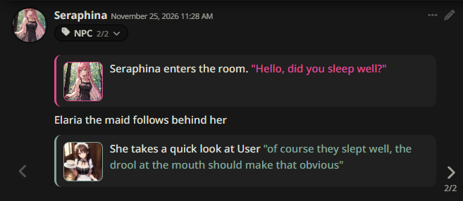

# NPC Book (SillyTavern extension)

I found Doom Enhancement SUite, RPGCompanion, SIM Tracker (etc, etc, etc) to be far too complicated and heavy for what I really care about. Which is "multiple-NPCs" in an "separate card-format" with "LLM can add/remove from scene and keep track of their state". So here is 'yet another' state tracker, which is light-weight (visually and in use), and does just that.

To prevent LLM Hallucination drift (User is standing, hair swaying in the wind, looking majestic) we use an ENUM-based approach, dictating what it can, and can not state (Standing, sitting, etc. It get's to pick one, or user can set it), exception is inner monologe(for obvious reasons).

**note:** 100% vibe-coded. I hate modding and extentions, so this is a quick way to get what I want without thinking about it too hard.

# Features:
- Dedicated NPC button to create NPCs (like lorebook/Character cards, but for 'characters', no longer do you have to choose a lesser of two evils).
- State tracking of Posture, Emotional state, inner thoughts, and outfit.
- Outfit tracking per body slot (paper doll): you or the LLM can put any clothing on anyone. Want NPCs to only wear what they own? Add the Wardrobe sister extension.
- Separate dressed-states to give the LLm headsup about what is currently the state (naked, has underwear on, etc).
- Full configuration of the Enum states, don't like a state? Change it.
- Profile generation if a character doesn't have one already.
- Speaker Cards with (optional) portrait' and their own dialogue color.
- Set starting cast in greetings (with per-greeting overrides).
- Export/import of characters
- LLM assisted Generation of character fields (if desired).
- Extendable: stat sheets, wardrobes, relationships or your own fields come as sister extensions (see below).




## Install
In SillyTavern, open **Extensions** (the stacked-cubes icon) → **Install extension**, paste this link and install:

```
https://github.com/lalzy/ST-NPC-Book
```

Or install it manually: download this repository and put the files in `SillyTavern/data/<your-user>/extensions/NPC-Book/`, then reload SillyTavern.

## Setup
1. Open **Extensions** → **NPC Book**, expand the **Injection** section and click **Add entries to Prompt Manager**.
2. Open your Prompt Manager. You'll find two new entries, *NPC Book — Instructions* and *NPC Book — Present NPCs*. Leave them where they are, or move them wherever you like.
3. Click the new **NPC Book** button in the top bar (next to Character Management) to start making NPCs.

Using Text Completion? There is no Prompt Manager there. In the **Injection** section, set **Mode** to *Auto inject* instead, or put `{{npcInstructions}}` and `{{npcScene}}` in your Story String yourself.

Every setting has an ⓘ icon: hover over it for a short explanation, or click it for the full text. Long prompts open in their own editor, with a **Reset to default** button.

## Using it

**NPC Library.** The top-bar button opens your NPCs. Each card has a name, portrait, dialogue color, starting outfit, a private description (only you see it) and details plus a profile (height, pronouns, sexuality…) that the AI is told.

**Scene bar.** Shown above the chat box: you on the left, then everyone currently in the scene. The AI adds and removes characters as the story moves. Use **+** to add someone yourself, or click a character to change their posture, mood, thoughts or outfit.

**Clothing.** Everyone has an outfit, shown as a paper doll: click a slot and type what they wear, or let the AI dress them (any clothing). To change what someone wears, click them and open **Outfit**. An NPC's starting outfit is on its card's **Outfit** tab; yours is under **Persona Management** → **Connections** → **NPC Book**. For wardrobes (the clothing each character owns, and only that), install **NPC Book — Wardrobe**.

**New characters.** When the AI introduces someone without a card, NPC Book creates one with details and what they wear. Characters with the same name but a different age or role are kept as separate people.

**Starting cast.** Put a `characters` block in a greeting or an alternate greeting. The block is removed from the message, and the characters are in the scene from the first message:

```json
{
  "characters": [
    {"id": "seraphina"},
    {"id": "suzie", "posture": "sitting", "feet": "black-socks"},
    {"id": "user", "posture": "lying down"}
  ]
}
```

Each character starts from their card. Any field you add overrides the card for that greeting only:

| Field | Example |
|---|---|
| `posture` | `"sitting"` |
| `mood` | `"nervous"` |
| `feelings` | `"Who is that?"` |
| `clothing` | `{"bottom-outer": "jeans", "feet": "none"}`: set or empty a slot (other slots keep the default outfit)<br>`["nothing", "pajamas (wet)"]`: undress, then put these on, with an optional condition in brackets<br>`"nothing"`: naked |

Any clothing can be named. Items already worn are matched loosely, so `"jeans"` finds "Blue Jeans" (with the Wardrobe extension, wardrobe items too, and new items join the wardrobe). Use `"id": "user"` to set your own starting posture and clothing.

**Speaker cards.** The AI wraps each character's part of a reply in an <npc> block, and each block shows as a card with their portrait on the left and their dialogue in their color (switch off under Portraits for plain text). Greetings can use the same blocks, so a card's opening message looks like the rest of the chat:

```html
The glade is quiet; morning light filters through the canopy.

<npc id="seraphina">*She looks up from the herbs.* "You're awake. How do you feel?"
She kneels by the bed and checks the bandages.</npc>

<npc id="suzie">*Suzie peeks around the doorframe.* "Is he okay?"</npc>
```

Use the character's NPC Library ID. Text outside a block is shown as normal narration. Start a new block whenever the focus moves to another character, and don't nest blocks. To change a character's portrait, click it on their NPC card: you can upload an image, pick one from the SillyTavern server, crop it, or generate one with the Image Generation extension. The portrait size is set under Extensions → NPC Book → Portraits. Characters without a portrait show their initials.

**Swipes.** Swiping or deleting a message rolls the scene back to that point.

**Settings.** Under **Extensions** → **NPC Book** you can set the postures, moods and clothing conditions the AI can choose from, edit the prompts it receives, and turn features on or off.

## Sister extensions
NPC Book can be extended by other extensions without forking it: stat sheets for any game system (Ironsworn, D&D, GURPS…), extra tracked fields (occupation, faction, reputation…), or changes to what the AI is told and what NPC Book reads from its replies. Extensions can add their own tabs to NPC cards and your persona, their own information to what the AI sees, and read what the AI writes about each character.

See **[EXTENDING.md](EXTENDING.md)** for the full guide and API, and [`examples/`](examples/) for two small, commented sister extensions (an occupation tracker and a simple stat sheet) to copy from.


## Existing sister extensions:
- **NPC Book — Wardrobe**: each NPC and your persona owns a wardrobe; outfits are limited to it, it is sent to the AI, new NPCs get one, and ✨ Generate fills it.
- **NPC Book — Relationships**: who knows whom and how they feel, with a web/tree view; tracked per chat by the AI.
- [Gurps Stat-sheet](https://github.com/lalzy/ST-NPCBook-Gurps)