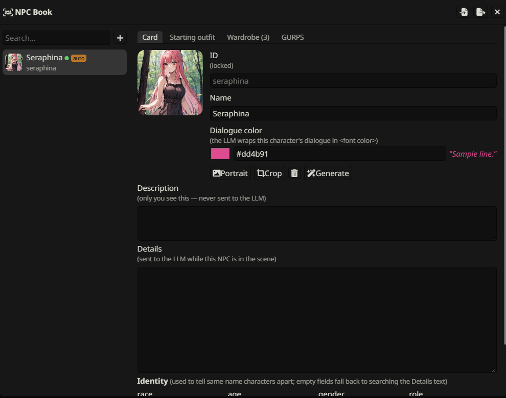

# NPC Book (SillyTavern extension)

I found Doom Enhancement SUite, RPGCompanion, SIM Tracker (etc, etc, etc) to be far too complicated and heavy for what I really care about. Which is "multiple-NPCs" in an "separate card-format" with "LLM can add/remove from scene and keep track of their state". So here is 'yet another' state tracker, which is light-weight (visually and in use), and does just that.

To prevent LLM Hallucination drift (User is standing, hair swaying in the wind, looking majestic) we use an ENUM-based approach, dictating what it can, and can not state (Standing, sitting, etc. It get's to pick one, or user can set it), exception is inner monologe(for obvious reasons).

# Features:
- Dedicated NPC button to create NPCs (like lorebook/Character cards, but for 'characters', no longer do you have to choose a lesser of two evils).
- State tracking of Posture, Emotional state, inner thoughts, and outfit.
- Separation of Outfit(currently wearing), and Wardrobe (all outfits the NPC owns and the LLm can pick between when changing clothing).
- Separate dressed-states to give the LLm headsup about what is currently the state (naked, has underwear on, etc).
- Full configuration of the Enum states, don't like a state? Change it.
- Profile generation if a character doesn't have one already.
- Vibe coded because I hate making extensions.





## Install
In SillyTavern, open **Extensions** (the stacked-cubes icon) → **Install extension**, paste this link and install:

```
https://github.com/lalzy/ST-NPC-Book
```

Or install it manually: download this repository and put the files in `SillyTavern/data/<your-user>/extensions/NPC-Book/`, then reload SillyTavern.

## Setup
1. Open **Extensions** → **NPC Book** and click **Add entries to Prompt Manager**.
2. Open your Prompt Manager. You'll find two new entries, *NPC Book — Instructions* and *NPC Book — Present NPCs*. Leave them where they are, or move them wherever you like.
3. Click the new **NPC Book** button in the top bar (next to Character Management) to start making NPCs.

Using Text Completion? There is no Prompt Manager there, so set **Mode** to *Auto inject* in the NPC Book settings instead.

## Using it

**Making NPCs.** The top-bar button opens your NPC Library. Each NPC gets a name, portrait, a description (only you see it), details (what the AI gets to know), a wardrobe and a dialogue color.

**The scene bar.** Above the chat box you'll see who is currently in the scene, with yourself on the far left. The AI adds and removes characters as the story moves along. You can also add someone with the **+** button, or click a character to change their posture, mood, thoughts or outfit yourself.

**Clothing.** Each NPC (and your persona) has a wardrobe. The AI can only dress characters from their own wardrobe, so no surprise outfits appear out of nowhere. Click a character and open the **Outfit** tab to change what they're wearing.

**Your persona.** Go to **Persona Management** → **Connections** → **NPC Book** to set up your own wardrobe and starting outfit.

**New characters.** When the AI introduces someone you haven't made, NPC Book creates a card for them automatically, complete with details and a wardrobe. Two characters with the same name but different ages or roles are kept apart.

**Starting a scene with characters.** Put a list in a greeting (or alternate greeting) and they'll be in the scene from the first message:

````
```json
characters[
  seraphina, sophia_housewife
]
```
````

**Dialogue colors and portraits.** Each NPC's lines are colored in their own color, and their portrait shows up next to their dialogue. Click a portrait on the NPC card to load an image from your device or from the SillyTavern server, crop it, or generate one with SillyTavern's Image Generation extension.

**Swipes.** Swiping or deleting a message also rolls the scene back to how it was at that point.

**Settings.** Everything can be adjusted under **Extensions** → **NPC Book**: the postures, moods and clothing conditions the AI can choose from, the prompts it receives, and which features are switched on.

## Sister extensions
NPC Book can be extended by other extensions, which can add their own tabs to NPC cards and your persona, and their own information to what the AI sees. See *NPC Book — GURPS* for an example.
